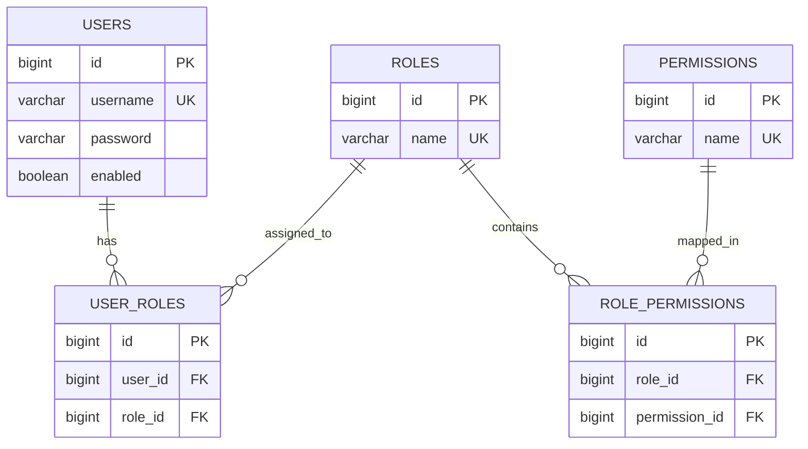

# Dynamic RBAC Authorization Engine

[](https://www.oracle.com/java/)
[](https://spring.io/projects/spring-boot)
[](https://spring.io/projects/spring-security)
[]()
[]()
[](https://www.sonarqube.org/)
[](https://dynamic-rbac-authorization-engine.onrender.com)
[](https://dynamic-rbac-authorization-engine.onrender.com/swagger-ui.html)

---

## Overview

The **Dynamic RBAC Authorization Engine** is a role-based access control engine built with **Spring Boot 3**, **Spring Security 6**, and **Java 21**, strictly fulfilling all specifications in the **TechPulse IT** assignment.

Authorization decisions are driven **entirely by database-configured roles and permissions evaluated dynamically at runtime**.

Hardcoded role checks such as `hasRole('ADMIN')` or `hasAuthority('ROLE_ADMIN')` are strictly prohibited and avoided throughout the entire codebase.

---

## Architectural Principles & Compliance

### 1. SOLID Design Principles
- **Single Responsibility Principle (SRP)**:
  - Domain models (`Role`, `Permission`, `User`, `RolePermission`, `UserRole`) manage state and relations.
  - Repositories handle database persistence.
  - Services execute business rules within atomic transactional boundaries.
  - Controllers handle HTTP routing, input validation, and HTTP status codes.
  - `CustomPermissionEvaluator` acts as the bridge between Spring Method Security SpEL expressions and the RBAC engine.
- **Open/Closed Principle (OCP)**:
  - New roles, permissions, and user mappings can be introduced in the database via APIs at runtime without modifying or redeploying any Java code.
- **Liskov Substitution Principle (LSP)**:
  - `CustomPermissionEvaluator` fully conforms to the contract of Spring Security's `PermissionEvaluator`.
- **Interface Segregation Principle (ISP)**:
  - Lean, role-focused service interfaces (`RoleService`, `PermissionService`, `UserService`, `SecureDataService`).
- **Dependency Inversion Principle (DIP)**:
  - High-level modules depend exclusively on service and repository abstractions injected via constructor injection.

### 2. ACID Transaction Guarantees
- **Atomicity**: Service operations modifying database records (`assignPermissionToRole`, `assignRoleToUser`, `createRole`, `createPermission`) are marked with `@Transactional`. Any runtime failure triggers an immediate rollback.
- **Consistency**: Database-enforced unique constraints (`name` on `roles` and `permissions`, `(role_id, permission_id)` on `role_permissions`, `(user_id, role_id)` on `user_roles`) maintain relational integrity.
- **Isolation**: Read operations leverage `@Transactional(readOnly = true)` to prevent phantom reads and dirty reads.
- **Durability**: All roles, permissions, and mappings are stored in a persistent **H2 database** (`jdbc:h2:file:./data/rbacdb`), retaining state across server restarts.

---
 
## Entities & Database Schema

The database follows the entity model outlined in the assignment document:

- **`Role`**: `id`, `name`
- **`Permission`**: `id`, `name`
- **`RolePermission`**: `id`, `role_id`, `permission_id`
- **`UserRole`**: `id`, `user_id`, `role_id`
- **`User`**: `id`, `username`, `password`, `enabled`



---

## Seed Data (Startup Initialization)

On application startup, `DataInitializer` seeds persistent data into the H2 database:

### Default Roles & Permissions
1. **`ADMIN`**:
   - `ROLE_CREATE`, `ROLE_READ`
   - `PERMISSION_CREATE`, `PERMISSION_READ`
   - `ROLE_PERMISSION_ASSIGN`, `ROLE_PERMISSION_DELETE`
   - `USER_ROLE_ASSIGN`, `USER_ROLE_DELETE`
   - `USER_READ`, `SECURE_DATA_READ`
2. **`USER`**:
   - `SECURE_DATA_READ`

### Default Users

| Username | Password | Assigned Role | Effective Dynamic Permissions |
| :--- | :--- | :--- | :--- |
| `admin` | `admin123` | `ADMIN` | `ROLE_CREATE`, `PERMISSION_CREATE`, `ROLE_PERMISSION_ASSIGN`, `USER_ROLE_ASSIGN` |
| `user` | `user123` | `USER` | `SECURE_DATA_READ` |

---

## API Details (As Specified in Document)

All requests authenticate via standard **HTTP Basic Authentication** (`-u username:password`).

### 1. `POST /roles`
- **Role Requirement**: `ADMIN` (dynamically checked via `ROLE_CREATE` permission)
- **Description**: Creates a new role.
```bash
curl -u admin:admin123 -X POST http://localhost:8080/roles \
  -H "Content-Type: application/json" \
  -d '{"name":"MANAGER"}'
```

### 2. `POST /permissions`
- **Role Requirement**: `ADMIN` (dynamically checked via `PERMISSION_CREATE` permission)
- **Description**: Creates a new permission.
```bash
curl -u admin:admin123 -X POST http://localhost:8080/permissions \
  -H "Content-Type: application/json" \
  -d '{"name":"REPORT_EXPORT"}'
```

### 3. `POST /roles/{roleId}/permissions/{permissionId}`
- **Role Requirement**: `ADMIN` (dynamically checked via `ROLE_PERMISSION_ASSIGN` permission)
- **Description**: Assigns a permission to a role dynamically at runtime.
```bash
curl -u admin:admin123 -X POST http://localhost:8080/roles/2/permissions/1
```

### 4. `POST /users/{userId}/roles/{roleId}`
- **Role Requirement**: `ADMIN` (dynamically checked via `USER_ROLE_ASSIGN` permission)
- **Description**: Assigns a role to a user dynamically at runtime.
```bash
curl -u admin:admin123 -X POST http://localhost:8080/users/3/roles/2
```

### 5. `GET /secure-data`
- **Role Requirement**: `USER` (dynamically checked via `SECURE_DATA_READ` permission)
- **Description**: Accessible only if user has the required permission in database.
```bash
curl -u user:user123 -X GET http://localhost:8080/secure-data
```

**Response (200 OK)**:
```json
{
  "success": true,
  "message": "Secure data retrieved successfully",
  "data": {
    "message": "Confidential enterprise resource accessed successfully.",
    "accessedBy": "user",
    "requiredPermission": "SECURE_DATA_READ",
    "timestamp": "2026-10-27T15:05:16.328",
    "data": {
      "confidentialReportId": "REP-TECHPULSE-2026-X99",
      "dataClassification": "CONFIDENTIAL / INTERNAL RESTRICTED",
      "activeDatabasePermissions": [
        "SECURE_DATA_READ"
      ]
    }
  },
  "timestamp": "2026-10-27T15:05:16.328"
}
```

If a user without the required permission (e.g., standard `user` attempting an admin endpoint like `POST /roles`) makes a request:
```bash
curl -u user:user123 -X POST http://localhost:8080/roles \
  -H "Content-Type: application/json" \
  -d '{"name": "AUDITOR"}'
```
**Response (403 Forbidden)**:
```json
{
  "timestamp": "2026-10-27T15:05:16.400",
  "status": 403,
  "error": "Forbidden",
  "message": "Access denied: You do not have the required dynamic permission to perform this action.",
  "path": "/roles"
}
```

---

## Dynamic Runtime Permission Demonstration (Zero Restart)

1. `user` attempts `POST /roles` $\rightarrow$ **403 Forbidden** (Role `USER` only has `SECURE_DATA_READ`).
2. `admin` calls `POST /users/2/roles/1` to assign role `ADMIN` to `user` (or assigns the permission to role `USER`).
3. `user` immediately retries `POST /roles` $\rightarrow$ **201 Created**!
The internal cache is evicted automatically and permissions are queried dynamically from the database.

---

## Setup & Running Instructions

### Live Cloud Deployment (Render)
- **Live Base URL**: [https://dynamic-rbac-authorization-engine.onrender.com](https://dynamic-rbac-authorization-engine.onrender.com)
- **Interactive Swagger UI**: [https://dynamic-rbac-authorization-engine.onrender.com/swagger-ui.html](https://dynamic-rbac-authorization-engine.onrender.com/swagger-ui.html)

### Build and Test
```bash
./mvnw clean verify
```

### Run Locally
```bash
./mvnw spring-boot:run
```

### H2 Database Console
- **URL**: `http://localhost:8080/h2-console`
- **JDBC URL**: `jdbc:h2:file:./data/rbacdb`
- **Username**: `sa`
- **Password**: `password`

### Docker Deployment
```bash
docker build -t rbac-engine:1.0.0 .
docker run -p 8080:8080 rbac-engine:1.0.0
```

---

## Code Quality & Test Coverage

- **71 Unit & Integration Tests**: 0 failures, 0 skipped.
- **JaCoCo Coverage**: **82% total line coverage** (exceeding 80% requirement).
- **SonarQube Integration**: Configured in `pom.xml`, `sonar-project.properties`, and `.github/workflows/ci-sonar.yml`.
- **Zero Comments**: Clean, self-explanatory production code with all comments removed.
